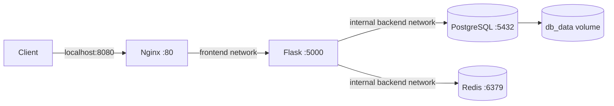

# DevOps Automation Stack

A project-based task API stack using Flask, PostgreSQL, Redis, Nginx, and Docker Compose. Nginx is the only service published to the host; PostgreSQL and Redis stay on an internal network.

## Architecture



## Start locally

Requirements: Docker Engine with the Compose plugin, Git, and `make` (optional).

```bash
git clone https://github.com/mhmdhmdbdh2050/devops-automation-stack.git
cd devops-automation-stack
cp .env.example .env
```

Edit `.env` and set a unique local `DB_PASS`, then run:

```bash
docker compose up -d --build
docker compose ps
curl http://localhost:8080/health
```

The API is available at `http://localhost:8080`. Do not commit `.env` or use the example password outside local development.

## API

- `GET /health` returns `{"status":"ok"}`.
- `GET /tasks` reads the task list from PostgreSQL and caches it in Redis for 30 seconds.
- `POST /tasks` accepts `{"title":"A task"}`; titles must be non-empty strings. Creating a task clears the cache.

Example:

```bash
curl -X POST http://localhost:8080/tasks \
  -H 'Content-Type: application/json' \
  -d '{"title":"Review deployment"}'
```

## Operations

```bash
./scripts/healthcheck.sh
./scripts/backup.sh
./scripts/restore.sh --replace backups/backup_<timestamp>.dump
```

Backups use PostgreSQL custom format, are validated before being saved, and are created with owner-only permissions. Restore replaces database objects included in the chosen archive. It validates the file and requires typing `RESTORE`; inspect the target database and keep a separate backup before proceeding. Backups are not automatically deleted.

`make clean` removes the Compose volumes and requires typing `DELETE`. This permanently deletes local database data.

## CI and verification

GitHub Actions runs on pushes and pull requests. It validates the Compose configuration, builds the Flask image, runs ShellCheck on the operational scripts, and exercises the API against temporary PostgreSQL and Redis service containers. The tests cover health, database reads, Redis caching/invalidation, task creation, and invalid titles.

These checks do not deploy the stack or prove behavior in a production environment. They run in GitHub Actions; a local run also requires Docker Engine and the Compose plugin.

## Project structure

```text
app/                 Flask API and Dockerfile
nginx/               Reverse proxy configuration
scripts/             Health, backup, and restore operations
tests/               API integration tests
docker-compose.yml   Local multi-service configuration
init.sql             Database schema initialization
```
